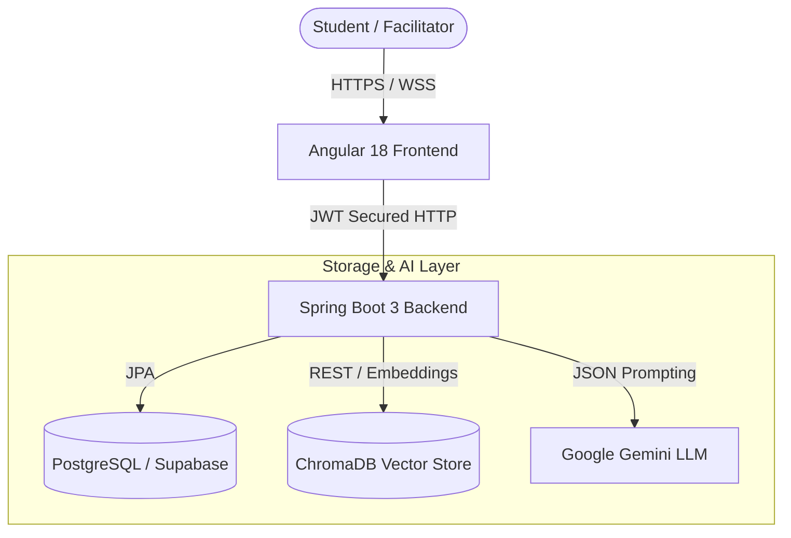

# Personalize or Perish
### *Intelligent Academic Support & Learning Analytics System*

Personalize or Perish is an AI-powered academic support platform designed to identify student learning gaps, generate customized study pathways, and provide educators with data-driven classroom analytics. By combining a **Spring Boot 3** backend and a reactive **Angular 18** client with a **Retrieval-Augmented Generation (RAG)** pipeline utilizing **ChromaDB** and the **Google Gemini API**, it delivers context-aware tutoring and personalized learning interventions.

---

## 🚀 Key Features

* **🤖 Semantic AI Tutor (RAG):** Upload syllabus documents to dynamically build a semantic vector store. Students can query the AI tutor, which references and cites specific course materials using Gemini and ChromaDB.
* **⚡ Personalized Study Plans:** Processes individual quiz submissions to detect weakness severity (`LOW`, `MEDIUM`, `HIGH`) and generates customized daily tasks to bridge knowledge gaps.
* **📈 Classroom Analytics:** Provides facilitators with class-wide diagnostics including average scores, toughest questions (high failure rates), and common classroom learning gaps.
* **📝 Interactive Quiz Runner:** Supports active assessments with auto-grading, dynamic navigation, progress indicators, and instant feedback.
* **🔒 Role-Based Access Control (RBAC):** Restricts features using stateless JWT bearer tokens, custom router guards on the client, and method-level access filters on the server.
* **✨ Glassmorphic UI:** Features a high-fidelity dark glassmorphic design system developed in vanilla CSS using HSL color variables and Angular Signals.

---

## 🛠️ Tech Stack

* **Backend:** Java 21, Spring Boot 3.3.2, Spring Security (JWT), Spring Data JPA, Spring Boot Actuator
* **Frontend:** Angular 18 (Standalone Components, Signals state management)
* **Databases:** PostgreSQL / Supabase (Relational), ChromaDB (Vector DB)
* **AI Engine:** Google Gemini API (`gemini-1.5-flash` for generation, `text-embedding-004` for 768-dim embeddings)
* **Infrastructure:** Docker, Docker Compose, Maven, Node.js, Render Blueprint

---

## 🏛️ System Architecture



---

## 🚦 Getting Started

### 📋 Prerequisites
* Docker & Docker Compose
* Java 21 JDK (optional, if running locally)
* Node.js v22+ (optional, if running frontend locally)
* A Google Gemini API Key

### 🔑 Environment Variables
Create a `.env` file in the root directory (based on `.env.example`):
```env
PORT=8080
DATABASE_URL=jdbc:postgresql://db.jqyndhcemhfrsaqjoine.supabase.co:5432/postgres?sslmode=require
DATABASE_USERNAME=postgres
DATABASE_PASSWORD=your_database_password
JWT_SECRET=super_secret_jwt_sign_key_should_be_long_enough
GEMINI_API_KEY=your_gemini_api_key_here
CHROMA_URL=http://localhost:8000
```

### 🐳 Run via Docker Compose
To build and start the entire stack (PostgreSQL, ChromaDB, and the Spring Boot API) in detached mode, run:
```bash
docker-compose up --build -d
```
* **Spring Boot API:** available at `http://localhost:8080`
* **Health Check:** available at `http://localhost:8080/actuator/health`
* **ChromaDB:** available at `http://localhost:8000`
* **PostgreSQL:** listening on port `5432`

### 💻 Run Frontend Locally
Navigate to the `/frontend` directory, install dependencies, and start the development server:
```bash
cd frontend
npm install
npm start
```
* **Frontend client:** available at `http://localhost:4200`

---

## ☁️ Deploying to Render

This repository includes a [`render.yaml`](file:///d:/Personalize-or-Perish/render.yaml) Blueprint for one-click deployment.

### Steps:
1. Push your changes to your Git repository (GitHub/GitLab).
2. Go to the **Render Dashboard** and click **New > Blueprint**.
3. Select your repository. Render will automatically detect `render.yaml` and configure:
   - **Environment:** Docker (`Dockerfile`)
   - **Health Check Path:** `/actuator/health`
   - **Database Connection:** Pre-configured with Supabase PostgreSQL (SSL enabled).
   - **JWT Secret:** Automatically generated securely.
4. Set your `GEMINI_API_KEY` in the Render environment variables prompt.
5. Click **Apply** to deploy. Once live, Render will verify `/actuator/health` and direct traffic to your service.

---

## 📡 API Reference

| Endpoint | Method | Role | Description |
|---|---|---|---|
| `/actuator/health` | GET | ALL | Application health status (Render Health Check) |
| `/actuator/info` | GET | ALL | Application build & runtime info |
| `/api/auth/register` | POST | ALL | Create a new user profile |
| `/api/auth/login` | POST | ALL | Authenticate credentials and return JWT |
| `/api/topics` | GET | STUDENT, FACILITATOR | List all academic topics |
| `/api/assessments` | GET | STUDENT, FACILITATOR | Fetch all assessments |
| `/api/assessments` | POST | FACILITATOR | Create a new assessment shell |
| `/api/assessments/{id}/questions` | POST | FACILITATOR | Add a question to an assessment |
| `/api/submissions` | POST | STUDENT | Submit answers to an assessment |
| `/api/analytics/student/{id}` | GET | STUDENT, FACILITATOR | Load student dashboard analytics |
| `/api/analytics/assessment/{id}`| GET | FACILITATOR | Load facilitator class metrics |
| `/api/learning-gaps/student/{id}`| GET | STUDENT, FACILITATOR | Load student learning gaps |
| `/api/study-plans/generate/{id}` | POST | STUDENT, FACILITATOR | Request Gemini to build a study plan |
| `/api/documents/upload` | POST | FACILITATOR | Upload a syllabus document to ChromaDB |
| `/api/tutor/chat` | POST | ALL | Message the RAG-based AI Tutor |

---

## 📄 License
This project is licensed under the MIT License - see the LICENSE file for details.
